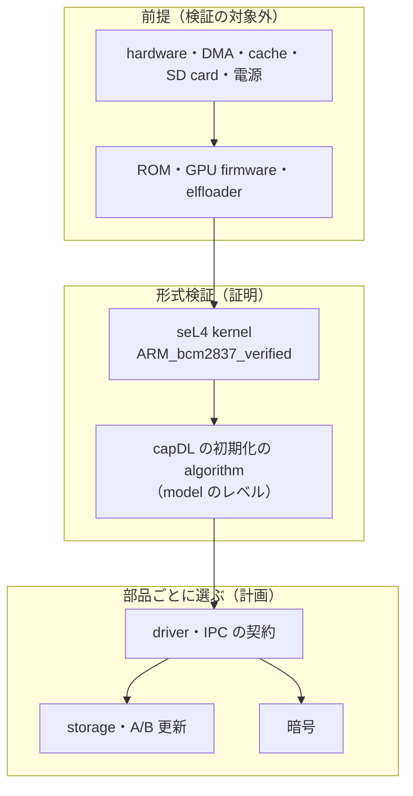
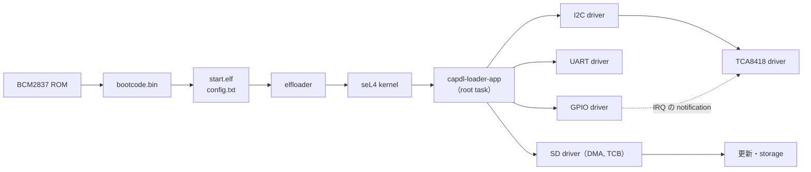

# MSD/seL4

[](https://deepwiki.com/uist1idrju3i/MSD-seL4)

MSD/seL4 は、M5Stack CardputerZero（Raspberry Pi CM0 = BCM2837、Cortex-A53、RAM 512 MB、microSD 起動）の上で seL4 microkernel を動かし、CardputerZero の全機能を使える状態を目指す実験的なプロジェクトです。姉妹プロジェクトに Linux を使う [MSD/Linux](https://github.com/uist1idrju3i/MSD-Linux) があります。

## 設計の柱

| 柱 | 方針 |
|---|---|
| seL4 を活かし切る | 検証済み構成の kernel を使い、システムを保護ドメインに分け、各部品に必要な権限（capability）だけを静的に渡します。証明が扱う範囲と扱わない範囲を明記します |
| 電源断で壊れない | いつ電源が落ちても、次の起動で正しい状態に戻れるようにします |
| 更新に失敗しても戻れる | 試験起動で合格したときだけ更新を確定し、失敗したら前の版へ自動で戻ります |
| ハードウェアをすべて使える | LCD、キーボード、音声、センサー、RTC、電池、IR、カメラ、無線、USB、Ethernet、HDMI、拡張端子の driver を、seL4 のユーザー空間に作ります |
| 費用に見合うセキュリティ | 脅威と費用を比べて対策を選び、検証されていない部品（driver、firmware）を必要以上に信頼しない構成にします |
| 検証できる | 証明、QEMU、実機で確かめたことを分けて記録し、確かめていないことを確認済みと書きません。kernel の外でも、実用になる範囲で形式検証を使い、部品ごとに確かめた方法と前提を公開します |

## 開発状況

開発の準備段階です。OS の実装、ビルド、実機での確認はまだありません。

- seL4 kernel: 17.0.0 を使い、検証済み構成 `ARM_bcm2837_verified`（AArch32、単一コア）を既定にする方針です。17.0.0 は改変なしでは起動処理の途中で止まるため、起動処理を直す patch（`patches/seL4/`）を build 時に当てています（[差分](research/sel4/verified-config-deviations.md)）。
- driver: すべて調査済みで、実装は未着手です（[research/drivers/README.md](research/drivers/README.md)）。driver ごとに計画を立て、確認を得てから実装します。

## 形式検証の範囲

MSD/seL4 を「全体が検証済みのシステム」とは呼びません。部品ごとに、確かめた方法を次の表で示します。準備段階のため、userland の部品はまだありません。

| 部品 | 確かめる方法 | 現在 |
|---|---|---|
| seL4 kernel（`ARM_bcm2837_verified`） | seL4 の証明（機能正当性、access control、情報フロー、バイナリ正当性） | 証明は上流にあり、改変なしの source が対象。起動処理の patch を当てた source では証明を再実行していない。検証済み構成で build でき、QEMU で root task が起動することを CI で確認 |
| system の初期化（capDL） | 初期化の algorithm の証明（model のレベル）と、仕様の検査 | 未着手 |
| IPC の契約、driver、storage、更新 | 部品ごとに、証明、model 検査、静的解析、試験を選ぶ | 未着手 |
| 起動（ROM、GPU firmware、elfloader） | 試験と review だけ（形式検証の対象外） | 未確認 |
| hardware | 対象外（前提） | - |

証明が前提にすることは、次のとおりです。

- hardware（CPU、MMU、cache、TLB、割り込み制御器、device の register）が仕様どおりに動き、改ざんされていないこと。
- kernel の起動処理、cache・TLB の操作、一部のアセンブリが正しいこと（seL4 の証明の対象外）。
- DMA を使う device が、渡した buffer の外に書かないこと。BCM2837 には IOMMU がないため、capability ではこれを強制できません。
- 暗号の基本部品と乱数の源が正しいこと。
- SD card と電源の回路が、仕様どおりに書き込みと電源断を扱うこと。

QEMU で動いても、CardputerZero の実機で動くことの確認にはなりません。kernel の証明は、userland の driver の正しさを証明しません。



## 起動の流れと部品の分離



各 driver は、自分の device の MMIO と IRQ の capability だけを持ちます。bus の上の device の driver（TCA8418 など）は、bus の driver への IPC だけで device に触れます。userland の基盤は capDL と `capdl-loader-app` に決めました。図の部品の分け方は計画で、まだ実装していません。

## リポジトリの構成

| パス | 内容 |
|---|---|
| `AGENTS.md` | 作業の規則（エージェントと人間の共通） |
| `.agents/skills/` | 作業手順のスキル（`.claude/skills/` からリンク） |
| `research/` | 内部の調査、設計、実験の記録 |
| `docs/` | GitHub Pages で公開するサイト |
| `vendor/` | 外部リポジトリ（shallow submodule、編集しない） |

## 取得

```sh
git clone https://github.com/uist1idrju3i/MSD-seL4.git
cd MSD-seL4
git submodule update --init --depth 1
```

## ライセンス

[BSD-3-Clause](LICENSE)。`vendor/` の外部コードは、それぞれのライセンスに従います（seL4 kernel は GPL-2.0-only、`libsel4` は BSD-2-Clause など）。
