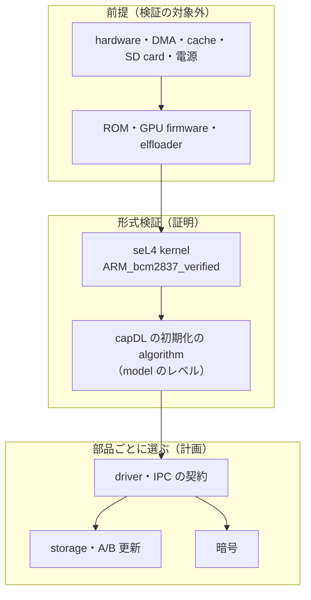
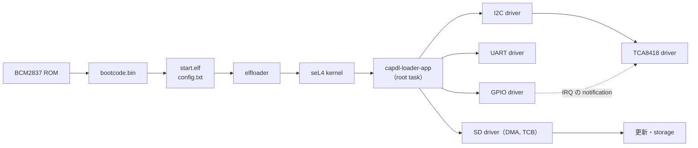

# MSD/seL4

[](https://deepwiki.com/uist1idrju3i/MSD-seL4)

MSD/seL4 は、ポケットサイズのコンピューター M5Stack CardputerZero（Raspberry Pi CM0 = BCM2837、Cortex-A53、RAM 512 MB、microSD 起動）の上で、形式検証された microkernel の seL4 を動かす実験的なプロジェクトです。最終的には、LCD、キーボード、音声、センサー、無線、USB などの全機能を、seL4 の分離と権限管理の上で使えるようにすることを目指します。姉妹プロジェクトに、Linux を使う [MSD/Linux](https://github.com/uist1idrju3i/MSD-Linux) があります。

**今の状態（2026-11）**: 実機ではまだ起動しません。検証済み構成の kernel を build し、QEMU の Raspberry Pi 3 の上で最小の root task（C と Rust）が動くところまでです。driver は全機種の調査が終わり、実装はこれからです。

## 読者別の入口

| 読者 | 最初に読むもの |
|---|---|
| どんなプロジェクトかを知りたい方 | この README と、公開サイト（[uist1idrju3i.github.io/MSD-seL4](https://uist1idrju3i.github.io/MSD-seL4/)） |
| seL4 や形式検証に関心のある方 | [形式検証の範囲](#形式検証の範囲)、[検証済み構成](research/sel4/verified-configuration.md)、[kernel 以外の形式検証](research/verification/beyond-kernel.md)、[Rust の検討](research/sel4/rust-adoption.md) |
| CardputerZero や組み込みの開発者 | [driver ごとの調査](research/drivers/README.md)、[DMA と IOMMU](research/drivers/dma-iommu.md)、[実機の確認の計画](research/experiments/hardware-checklist.md) |
| 手元で build したい方 | [試し方](#試し方)と [開発環境](docker/README.md) |
| 開発に参加する方・AI エージェント | [AGENTS.md](AGENTS.md)（作業の規則）と [調査の索引](research/README.md) |

## 設計の柱

| 柱 | 方針 |
|---|---|
| seL4 を活かし切る | 検証済み構成の kernel を使い、システムを保護ドメインに分け、各部品に必要な権限（capability）だけを静的に渡します。証明が扱う範囲と扱わない範囲を明記します |
| 電源断で壊れない | いつ電源が落ちても、次の起動で正しい状態に戻れるようにします |
| 更新に失敗しても戻れる | 試験起動で合格したときだけ更新を確定し、失敗したら前の版へ自動で戻ります |
| ハードウェアをすべて使える | LCD、キーボード、音声、センサー、RTC、電池、IR、カメラ、無線、USB、Ethernet、HDMI、拡張端子の driver を、seL4 のユーザー空間に作ります |
| 費用に見合うセキュリティ | 脅威と費用を比べて対策を選び、検証されていない部品（driver、firmware）を必要以上に信頼しない構成にします |
| 検証できる | 証明、QEMU、実機で確かめたことを分けて記録し、確かめていないことを確認済みと書きません。kernel の外でも、実用になる範囲で形式検証を使い、部品ごとに確かめた方法と前提を公開します |

## 開発状況

| 項目 | 状態 | 確かめ方 |
|---|---|---|
| seL4 kernel（17.0.0、`ARM_bcm2837_verified`） | build できる。17.0.0 は改変なしでは起動処理の途中で止まるため、起動処理を直す patch（`patches/seL4/`）を build 時の写しに当てる（[差分](research/sel4/verified-config-deviations.md)） | CI（QEMU だけ） |
| root task | C と Rust（rust-sel4 v6.0.0）の最小の root task が UART に出力する | CI（QEMU だけ） |
| userland の基盤 | capDL と `capdl-loader-app` に決定。generator は未着手 | - |
| driver | 全機種の調査済み、実装は未着手（[状況](research/drivers/README.md)） | - |
| 電源断、更新、storage | 未着手 | - |
| 実機（CardputerZero） | 未確認 | - |

## 形式検証の範囲

MSD/seL4 を「全体が検証済みのシステム」とは呼びません。部品ごとに、確かめた方法を次の表で示します。準備段階のため、userland の部品はまだありません。

| 部品 | 確かめる方法 | 現在 |
|---|---|---|
| seL4 kernel（`ARM_bcm2837_verified`） | seL4 の証明（機能正当性、access control、情報フロー、バイナリ正当性） | 証明は上流にあり、改変なしの source が対象。起動処理の patch を当てた source では証明を再実行していない。検証済み構成で build でき、QEMU で C と Rust の root task が起動することを CI で確認 |
| system の初期化（capDL） | 初期化の algorithm の証明（model のレベル）と、仕様の検査 | 未着手 |
| IPC の契約、driver、storage、更新 | 部品ごとに、証明、model 検査、静的解析、試験を選ぶ | 未着手 |
| 起動（ROM、GPU firmware、elfloader） | 試験と review だけ（形式検証の対象外） | 未確認 |
| hardware | 対象外（前提） | - |

証明が前提にすることは、次のとおりです。

- hardware（CPU、MMU、cache、TLB、割り込み制御器、device の register）が仕様どおりに動き、改ざんされていないこと。
- kernel の起動処理、cache・TLB の操作、一部のアセンブリが正しいこと（seL4 の証明の対象外）。
- DMA を使う device が、渡した buffer の外に書かないこと。BCM2837 には IOMMU がないため、capability ではこれを強制できません（[DMA の方針](research/drivers/dma-iommu.md)）。
- user の部品が device の register に書いても、kernel が使う割り込みの mask は変わらないこと。BCM2837 では mailbox が割り込み制御器と同じ page にあるため、mailbox の driver がこの前提を守る必要があります（[調査](research/sel4/shared-intc-page.md)）。
- 暗号の基本部品と乱数の源が正しいこと。
- SD card と電源の回路が、仕様どおりに書き込みと電源断を扱うこと。

QEMU で動いても、CardputerZero の実機で動くことの確認にはなりません。kernel の証明は、userland の driver の正しさを証明しません。



## 起動の流れと部品の分離



各 driver は、自分の device の MMIO と IRQ の capability だけを持ちます。bus の上の device の driver（TCA8418 など）は、bus の driver への IPC だけで device に触れます。userland の基盤は capDL と `capdl-loader-app` に決めました。図の部品の分け方は計画で、まだ実装していません。

## 試し方

Docker と git があれば、Linux の上で試せます。QEMU で動いても、実機で動くことの確認にはなりません。

```sh
git clone https://github.com/uist1idrju3i/MSD-seL4.git
cd MSD-seL4
git submodule update --init --depth 1
docker/msd-sel4-dev ensure                          # 開発用 image を取得する（なければ build）
docker/msd-sel4-dev tools/build-verified-kernel.sh  # 検証済み構成の kernel を build して構成を照合する
docker/msd-sel4-dev tools/qemu-smoke.sh             # C の root task を QEMU raspi3b で起動する
```

Rust の root task は `projects/rust-smoke/build.sh build/smoke` で build し、`MSD_SMOKE_ROOTSERVER` で差し替えて起動します（手順は [Rust の実験記録](research/experiments/2026-11-11-rust-root-task-qemu.md)）。

## リポジトリの構成

| パス | 内容 |
|---|---|
| `AGENTS.md` | 作業の規則（エージェントと人間の共通） |
| `.agents/skills/` | 作業手順のスキル（`.claude/skills/` からリンク） |
| `research/` | 内部の調査、設計、実験の記録（[索引](research/README.md)） |
| `docs/` | GitHub Pages で公開するサイト |
| `docker/` | 共通の開発環境（[説明](docker/README.md)） |
| `tools/` | kernel の build、patch の適用、QEMU の smoke test |
| `projects/` | 最小の root task（`smoke` は C、`rust-smoke` は Rust） |
| `patches/seL4/` | seL4 に当てる patch（上流が直したら外す） |
| `tests/` | 検査 script の試験 |
| `vendor/` | 外部リポジトリ（shallow submodule、編集しない） |

## ライセンス

[BSD-3-Clause](LICENSE)。`vendor/` の外部コードは、それぞれのライセンスに従います（seL4 kernel は GPL-2.0-only、`libsel4` は BSD-2-Clause、rust-sel4 は BSD-2-Clause と MIT など）。GPL のコード（Linux、M5Stack の driver）は仕様を読む資料にだけ使い、写していません。
